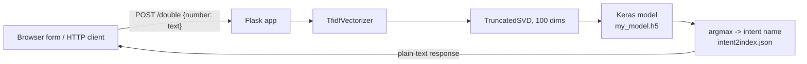

# Deploy model: Vietnamese intent classification

A small Flask web app that serves a Keras text classifier for **Vietnamese recruitment chat messages**.
The model sorts candidates' messages to a recruiter into one of **22 intents**: greetings,
interview time, salary, how to apply, confirming that a CV was sent, and so on.
Text is turned into TF-IDF vectors, reduced to 100 dimensions with truncated SVD and passed to a
neural network (LSTM + dense layers). The app has a one-field HTML form and a JSON endpoint
that returns the predicted intent.



## Highlights

- 763 labelled Vietnamese utterances in `train_intents.tsv`, 22 intent labels (`intent2index.json`).
- Model (`my_model.h5`, Keras 2.11, about 12 MB): input of 100 SVD features, reshaped to one time step,
  then an LSTM(256), six Dense layers (512 to 128 units, ReLU) and a softmax over 22 classes.
- The TF-IDF vectoriser and SVD (100 components, `random_state=42`) are stored in
  `preprocess.joblib`. They were fitted once on the original training text with scikit-learn 1.2.2,
  which reproduces the features the model was trained on. The shipped model labels **98.4 % of the
  training utterances** correctly. This is a training-set check, not a held-out score; no test set is
  in the repo. The pickle needs the pinned `scikit-learn==1.2.2` to load. (Originally the app re-fitted
  TF-IDF/SVD at every start; with scikit-learn 1.9.1 that silently dropped the same check to 47 %.)

## Tech stack

Python 3.11, TensorFlow / Keras 2 (2.11 to 2.15), scikit-learn 1.2.2, pandas, Flask, Docker.

## Repository structure

```
.
├── deploy_model_1/
│   ├── app.py               # Flask app: loads the model and preprocessor, serves / and /double
│   ├── my_model.h5          # trained Keras model (about 12 MB, needed at runtime)
│   ├── preprocess.joblib    # fitted TF-IDF vectoriser + truncated SVD
│   ├── train_intents.tsv    # training utterances (anonymised): text <TAB> intent id
│   ├── intent2index.json    # intent name -> class id
│   └── templates/
│       └── index.html       # minimal input form
├── Dockerfile
├── requirements.txt
└── LICENSE
```

## Getting started

### Docker

```bash
docker build -t textclf .
docker run --rm -p 5000:5000 textclf
```

### Local Python

```bash
python3.11 -m venv .venv && source .venv/bin/activate   # TensorFlow 2.15 supports Python 3.9-3.11
pip install -r requirements.txt
python deploy_model_1/app.py            # listens on 127.0.0.1:5000 (set HOST / PORT to change)
```

Open <http://localhost:5000> and type a message, or call the endpoint directly:

```bash
curl -X POST http://localhost:5000/double \
     -H 'Content-Type: application/json' \
     -d '{"number": "cho em hỏi mức lương thực tập là bao nhiêu ạ"}'
# -> salary
```

The endpoint and its JSON key are called `double` / `number` because the code started from a
Flask template. The value is the message text. The app uses Flask's development server, which
is fine for a demo but is not a production WSGI server.

## Data

`train_intents.tsv` holds short Vietnamese chat messages from candidates applying for internships,
already word-segmented (multi-syllable words joined with `_`). Each line has the message, a tab
and the intent id. The data is anonymised: candidates' and the recruiter's names were replaced
with fictional names, and the company name and HR address with placeholders. The same
replacement was applied to the vocabulary in `preprocess.joblib`, so the model's features are unchanged.

## License

Released under the [MIT License](LICENSE).
